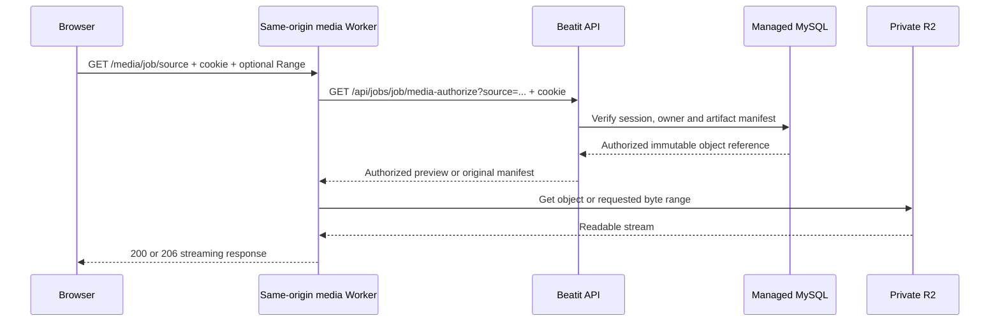

# Private media delivery

Beatit can serve playback bytes directly from private R2 through a Cloudflare
Worker while the Python application continues to authorize every request. Only
session/ownership/manifest metadata crosses the application origin path; the audio
body flows from R2 to the Worker to the browser.

The earlier `dcef260`
[managed deployment record](benchmarks/multiuser-managed-2026-11-09.json) precedes
this media change. The media Worker was subsequently deployed as version
`31fd3ed7-8682-4712-9f3b-882155bf0bd1`, including `audio/mp4` support. The current
origin image is `beatit:issue7-7c00a2c`; seven completed jobs were backfilled and
AAC browser playback was verified. See the
[follow-up record](benchmarks/multiuser-followup-2026-11-09.json). Direct Worker
delivery alone did not eliminate the earlier raw-audio buffering reproduced below.

## Request and authorization path



The implemented route is `/media/{job}/{source}`, with a 32-character job ID and a
fixed audio allowlist: `audio.wav`, `drums.wav`, and the five `stem-*.flac` kit
tracks. Arbitrary keys, score downloads and query-string substitutions are not
accepted. The Worker forwards the browser's existing HttpOnly session cookie to
the same-origin API; it does not decode a client identity or trust a user ID in the
URL. The API checks the revocable database session, owner and committed artifact
manifest without downloading R2 bytes or hydrating application scratch. For source
and drum playback, the API can select a matching AAC derivative as described below;
the Worker still receives only the authorized manifest.

Each GET, HEAD and range request obtains a fresh authorization decision. There is
no permission cache or reusable signed object URL. Anonymous requests receive 401;
an authenticated different owner receives 404. Revocation or expiry causes the
next request to receive 401. A missing object is 404; an unavailable authorization
or storage dependency fails closed with 503. The media route does not weaken the
existing API's ownership checks.

All responses use `Cache-Control: private, no-store` and `Vary: Cookie`.
`Cross-Origin-Resource-Policy: same-origin` and an explicit cross-site request
check keep the route on the application origin. No public bucket, browser-held R2
credential, CORS relaxation or bearer download link is introduced. Score/ZIP
exports remain on the authenticated API download path.

[R2 presigned URLs](https://developers.cloudflare.com/r2/api/s3/presigned-urls/)
authorize their holder until expiry. For Beatit, this implies that revoking the
application session would not revoke an already issued direct R2 link. Rechecking
the database for every media request retains Beatit's session-revocation behavior
without waiting for a URL TTL. That
check occurs when the request starts: logout cannot recall bytes already delivered
or cached in the player's memory, and it does not cancel an already authorized
in-flight response. The next network request must authorize again. Origin/database
availability and authorization latency therefore remain part of every new request.

## AAC playback derivatives and original quality

Interactive source and drum playback can use a **lossy AAC preview with a 96 kbit/s
target bitrate**, stored in a fast-start M4A container. This reduces the bytes a
player needs to sustain playback. It does not improve recognition accuracy or
change the inference, events or score. It is a listening preview, not a claim of
lossless or perceptually identical audio. The stored `audio.wav` and `drums.wav`
originals remain byte-for-byte intact in private R2 and on their authenticated API
download paths; source uploads are also preserved. Lossy input recordings do not
become lossless merely because their decoded processing copy is WAV.

`playback_preview.py` derives `audio-preview.m4a` and `drums-preview.m4a` using
[FFmpeg's native AAC encoder](https://ffmpeg.org/ffmpeg-codecs.html), `-b:a 96k`,
one encoder thread and [`+faststart`](https://ffmpeg.org/ffmpeg-formats.html). Fast-start
places container metadata before the media payload so a browser can begin decoding
without fetching the file's tail first. The command strips inherited metadata and
does not alter Beatit's tempo/offset settings. Kit-stem FLACs retain their existing
playback representation.

The `playback-previews.json` sidecar records profile `aac-96k-faststart-v1`, the
original WAV SHA-256, preview SHA-256 and preview byte count for each source. The
API selects an AAC object only if the committed preview manifest and sidecar have
the expected profile and both source/output hashes match the current artifacts.
The request path stays `/media/{job}/audio.wav` or `/media/{job}/drums.wav`, while a
selected AAC response has `Content-Type: audio/mp4`, the preview's size and ETag,
and byte ranges over that M4A object. Clients must follow response headers rather
than infer its format from the path suffix. The original
`/api/jobs/{job}/files/audio.wav` and `drums.wav` downloads still return the original
WAV bytes.

Missing previews, absent/malformed sidecars, an obsolete profile or hash mismatch
select the original WAV. FFmpeg absence, invalid WAV input, encoder failure or
timeout is recorded as a preview failure with raw fallback; preview preparation
is best effort and does not require rerunning model inference. Normal object-store
publication failures retain the usual recoverable/fenced publication behavior.
This fallback preserves access but may retain the raw stream's bandwidth needs.

Successful claim publication prepares the derivatives before capturing durable
artifacts, then persists the M4A objects and SHA/profile sidecar alongside the
existing media. Restored unchanged previews are reused when their hashes/profile
match, including during score revisions, without running the encoder again. The
source selection still performs the same owner/session/manifest checks for every
request; AAC does not introduce a public or transferable download URL.

Real FFmpeg tests checked a two-second fixture's decoded duration, zero start time,
stereo/44.1-kHz output and size below one eighth of that fixture's WAV. These are
encoder/format regression checks, not a production quality evaluation, a guaranteed
compression ratio for arbitrary audio, or proof of smooth browser playback. The
AAC-aware Worker tests passed 22 cases and the focused backend run passed 36 tests;
the deployed long-song browser result is recorded below.

### Backfill an existing completed job

After deploying the origin image containing the preview module, an operator can
backfill one explicitly owned, completed job. Obtain the stable database owner ID
from the intended owner's authenticated `/api/auth/me` response and the exact job
ID; never guess ownership from a filename or email. The following runs inside the
correct configured application container and prints only derived filenames/status:

```sh
cd /home/ubuntu/services/beatit-multiuser
docker compose -p beatit-multiuser --env-file .env \
  -f compose.yaml -f compose.mysql-tls.yaml exec -T beatit \
  python - JOB_ID OWNER_DATABASE_ID <<'PYTHON'
import json
import sys
import tempfile
from pathlib import Path
from transcription.store import JobStore

job_id, owner_id = sys.argv[1:]
with tempfile.TemporaryDirectory(prefix="beatit-preview-backfill-") as scratch:
    store = JobStore(Path(scratch))
    try:
        report = store.backfill_playback_previews(job_id, owner_id=owner_id)
        print(json.dumps(report, ensure_ascii=False))
    finally:
        store.close()
PYTHON
```

This may fetch private source media and encode it locally with FFmpeg. It publishes
only preview artifact references and the sidecar payload. It does not change job
`result`, `updated`, options, original artifacts or revision count, and does not
enqueue inference. Before publication it rechecks the owner, completed result and
original hashes under transaction locks; a concurrent job/audio change aborts the
backfill for a later retry. Repeating an unchanged backfill reuses matching outputs.
Bulk backfill must enumerate the intended exact job/owner pairs, not infer a
shared owner for unrelated records. The seven-job production backfill completed
with no encoding failures; original score state and manifests were verified unchanged.

## Streaming and ranges

The Worker uses its R2 binding's `get()` body directly as the HTTP response stream.
It requests a bounded R2 range when the browser requests one; it does not buffer or
download the whole audio file before returning that range. HEAD reads object
metadata without downloading a body. The Worker checks the returned object's total
size against the authorized manifest. Its quoted ETag is the manifest's SHA-256;
it does not recompute a full-file hash for each streamed range.

| Request | Response contract |
| --- | --- |
| GET without Range | 200, full object body |
| HEAD without Range | 200, object headers and no body |
| `Range: bytes=100-199` | 206 for those bytes, clipped at the object end |
| `Range: bytes=100-` | 206 from the offset through the end |
| `Range: bytes=-100` | 206 for the final 100 bytes, or the whole shorter object |
| Unsatisfiable, malformed or multipart range | 416 with `Content-Range: bytes */SIZE` |
| If-Range matching the current quoted ETag | Honor the requested single range |
| If-Range mismatch | 200 with the full current object |

Responses include `Accept-Ranges`, accurate `Content-Length`, and `Content-Range`
for partial responses. `X-Beatit-Media: r2-edge` identifies this delivery path.
Only GET and HEAD are accepted. The implementation supports single byte ranges;
it does not implement multipart range responses.

Cloudflare's [R2 Workers API reference](https://developers.cloudflare.com/r2/api/workers/workers-api-reference/)
documents bucket bindings, metadata-only `head()`, ranged `get()` and streaming
object bodies. The [Worker routes documentation](https://developers.cloudflare.com/workers/configuration/routing/routes/)
describes routing a selected URL pattern on an existing proxied hostname. Beatit's
`/media/*` route leaves `/api/*` on the existing application origin path.

## Configuration and rollout

`BEATIT_MEDIA_BASE_URL` accepts exactly two values:

| Value | Playback route |
| --- | --- |
| Empty string, the default | Existing authenticated `/api/jobs/{job}/files/{source}` relay |
| `/media` | Same-origin Worker `/media/{job}/{source}` |

An arbitrary host or URL is rejected at application startup. Compose passes this
setting explicitly, and the authenticated `/api/system` response reports it as
`media_base_url`. The Worker expects the canonical `APP_ORIGIN`, the existing
private bucket bound as `MEDIA`, and a route limited to
`beatit.changkyun.kim/media/*`. Its configuration disables workers.dev and preview
URLs. Wrangler is pinned to `4.158.0`; local `.wrangler` state is ignored.

Deploy the application containing `media-authorize` with the empty default first.
Deploy and verify the Worker using the existing account and bucket configuration:

```sh
cd cloudflare/media
npm ci
npm test
npm run deploy
```

Use the protected operator authentication already configured for that account;
keep credentials and session cookies out of shell output, tracked files and logs.
After checking the route's authorization and range behavior, set
`BEATIT_MEDIA_BASE_URL=/media` in the protected deployment environment and recreate
the correct application project:

```sh
cd /home/ubuntu/services/beatit-multiuser
docker compose -p beatit-multiuser --env-file .env \
  -f compose.yaml -f compose.mysql-tls.yaml up -d --no-build --wait
```

Verify an authenticated full request, seek/range, HEAD, invalid range, an anonymous
request, a different owner's request and a revoked session's subsequent request.
Check the `r2-edge` header, content type, selected preview size/ETag and partial
byte counts, then exercise playback, source/stem changes and seeks in the browser.
Verify an older/missing-preview job still falls back to its original. Record both
the application image and Worker version with those observations. Deploying the
AAC-capable Worker alone does not create previews on the origin or backfill old
jobs.

For rollback, restore the empty `BEATIT_MEDIA_BASE_URL` value and recreate the
application. Playback then uses the authenticated relay again. The private bucket
and existing application/Tunnel routes stay in place. Keep the scoped Worker route
until no clients depend on it; any route removal must target only this media route.

## Relay fallback and browser buffering

The relay still hydrates and SHA-verifies a whole object on its first cold read.
Warm scratch-cache reads avoid another R2 download. Its cache now uses a lock per
object and a fast cache-hit check, so a cold stem download does not hold the shared
job/process lock or block an unrelated cached source. Concurrent readers of the
same cold object share one verified transfer. Waveform generation and non-edge
artifact access continue to use this cache; their behavior is separate from the
Worker's streaming path.

The player requests `preload="auto"` and shows an explicit buffering state.
While enabled source audio is waiting/seeking, the matching synthesized-drum clock
is held; playback resumes against the media clock when it starts playing. Preload
is a browser hint, not a guarantee that a whole song is downloaded. Authentication,
range streaming, cache independence and buffer feedback address different parts
of the playback path; none establishes a full-song no-stutter guarantee by itself.

## Measured origin diagnostic (2026-11-09)

The ignored local record `work/issue7/media-delivery-probe-2026-11-09.json` contains
one observation per condition using the existing eight-second verification audio:
1,411,278 bytes of source WAV, 1,411,244 bytes of drum WAV, and a 175,693-byte kick
FLAC. Source size corresponds to about 1.411 Mbit/s, including its header.

Measurements used FastAPI TestClient inside chunsik's production container with
real OCI manifest reads and private R2 objects. Authorization was overridden only
inside that isolated diagnostic process for the fixture's known owner. It created
no auth rows, changed no installed application files and used a fresh temporary
cache per condition; the production cache was left untouched. The candidate was
loaded into an isolated module. This was not a public network or browser test.

| Operation, milliseconds | Previous global cache lock | Candidate per-object lock |
| --- | ---: | ---: |
| Cold first 65,536-byte range | 248.682 | 311.079 |
| Warm first 65,536-byte range | 12.943 | 13.156 |
| Warm seek 65,536-byte range | 11.808 | 11.510 |
| Warm full 1,411,278-byte response | 16.415 | 16.426 |
| Warm lookup during an unrelated cold drums download | 72.060 | 4.578 |
| Concurrent pair total | 102.401 | 120.714 |

Both range cases returned 206 with exact range/length headers; full reads returned
200 with the expected bytes. Cold relay reads fetched and verified the entire
object even for a short range. The candidate reduced this one observation's
unrelated warm lookup wait; its cold read and concurrent-pair total were slower.
These samples do not establish an overall speedup or a bandwidth distribution.

The baseline cold operation fetched/verified about 1.41 MB in 248.7 ms, whereas the
fixture's playback consumes about 176.4 KB/s. That single backend observation does
not establish an R2 throughput shortage. It also excludes public Cloudflare-to-
browser delivery, HTMLMediaElement buffering, long-song working sets, client
network variability and user-visible stutter. It predates Worker deployment. Measure
cold and warm playback/seek behavior through the deployed media route before
attributing a user-visible improvement to it.

## Observed raw public delivery and browser underrun

A later initial public Worker read returned the full 1,411,278-byte, eight-second
raw source in 8.204 seconds: about 1.38 Mbit/s for that one transfer, close to the
raw fixture's roughly 1.41-Mbit/s playback requirement. Its cache condition was
not classified as a controlled cold/warm pair. This public-path observation is
separate from the much faster origin-only measurements above; neither establishes
a general R2 bandwidth limit or identifies which network hop controlled delivery.

Actual Mac Chrome playback was then checked with a 48.529-MB raw source lasting
275.11 seconds. A buffer underrun was reproduced: the player exposed visible
buffering and `readyState=2`, with playback time 4.435 seconds and buffered end
5.641 seconds at the sampled state. The diagnostic was paused. Direct R2-to-Worker
streaming therefore did not, by itself, establish smooth raw-WAV playback on this
browser/network path.

After backfill, that recording's AAC preview was 3,365,915 bytes rather than
48,529,490 WAV bytes, a 93.06% reduction. Mac Chrome exposed `readyState=4`; a
53.386-second observation advanced the media clock from 0.071 to 53.405 seconds
without buffer starvation, and the recording eventually fully buffered through
275.11 seconds. The operator confirmed uninterrupted streaming. This is a
functional observation of that client/path, not a throughput or quality guarantee.

The eight-second fixture's 79,293-byte AAC was then delivered through the public
Worker in 1.427 seconds, with first byte at 1.031 seconds. Its complete SHA-256
matched the selected preview manifest. Full/partial/suffix reads, HEAD, 416,
anonymous denial, cross-owner denial and revocation of the next range request
passed against real OCI/R2 using two tagged synthetic sessions. Those identities
were removed without deleting source objects. The probe does not establish a
latency distribution, and its byte rate includes authorization/first-byte delay.
